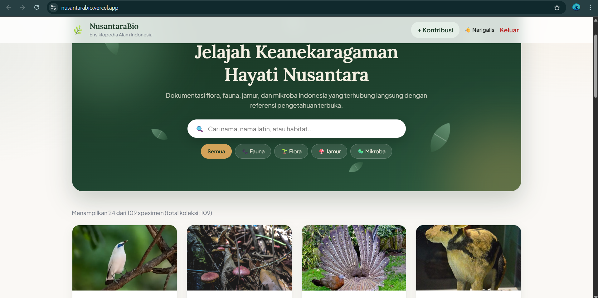
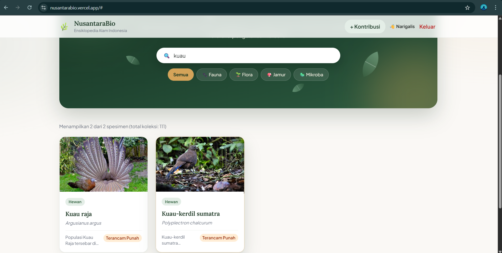
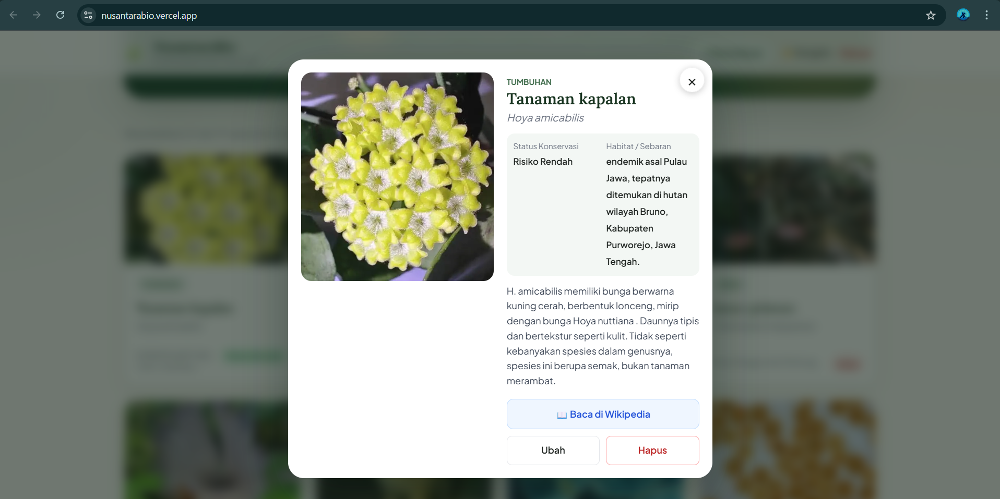
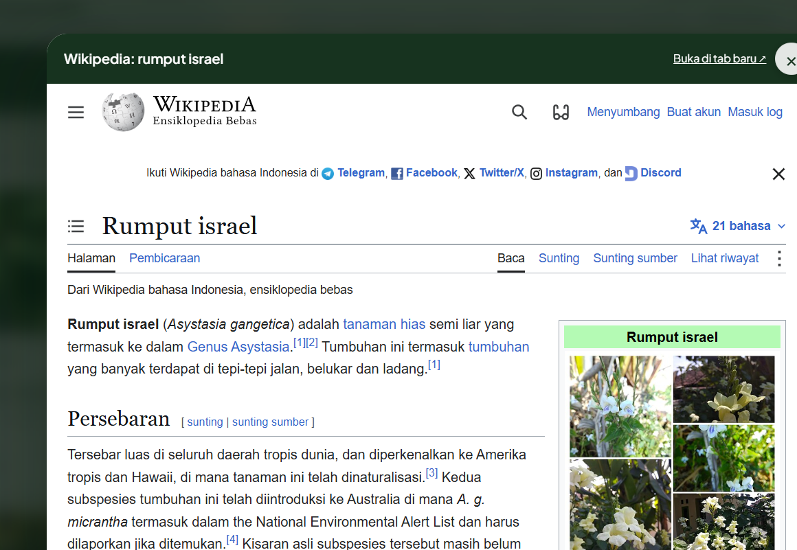
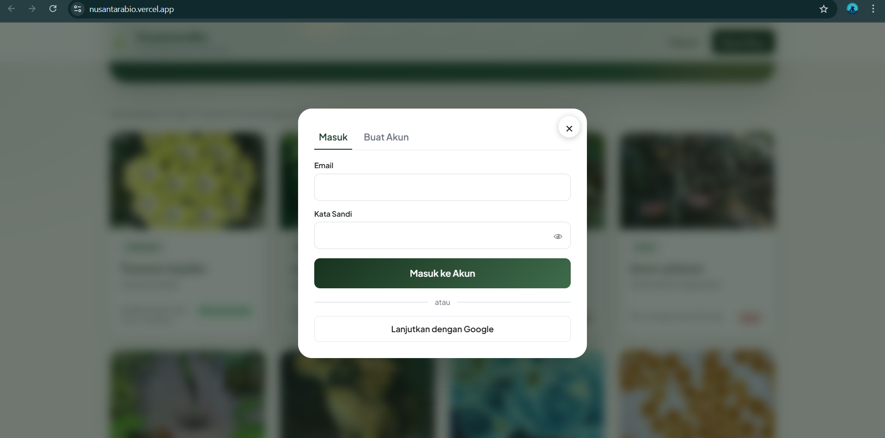
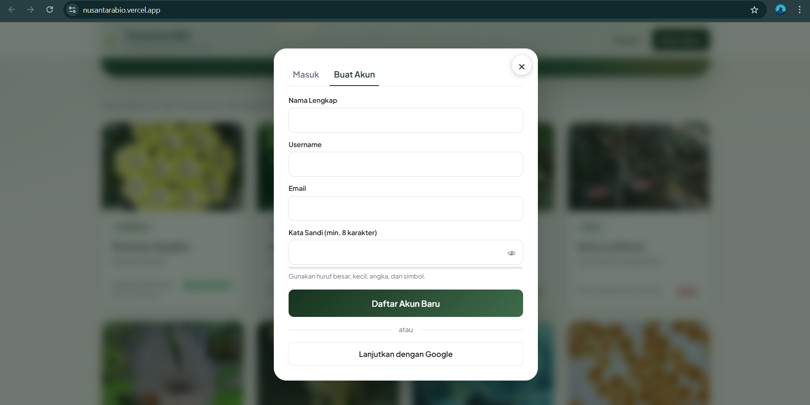
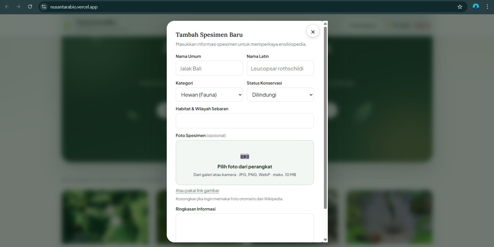
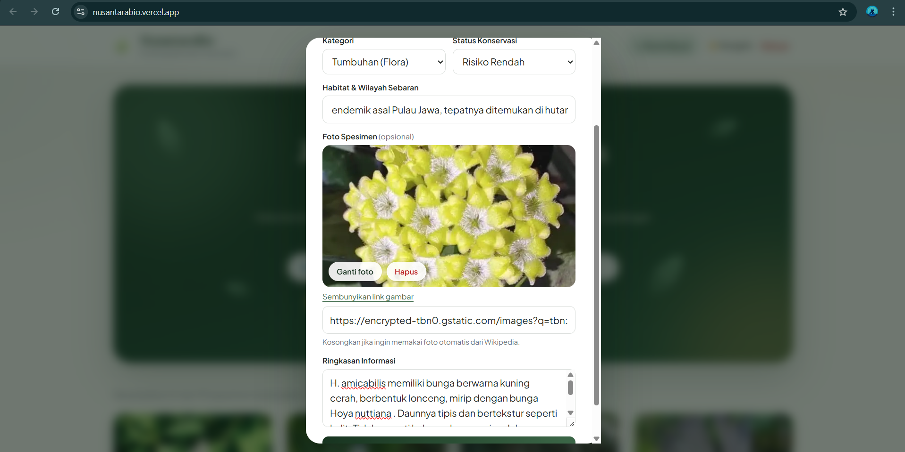
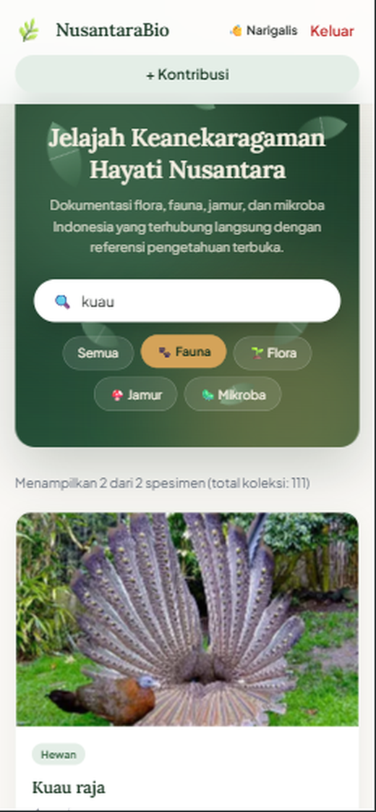
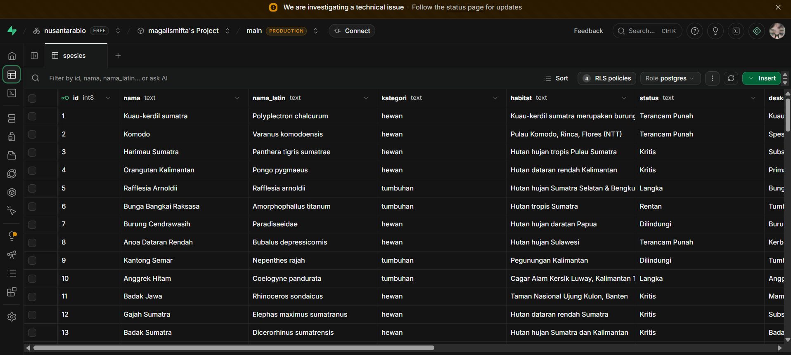

# 🌿 NusantaraBio

**Ensiklopedia flora, fauna, jamur, dan mikroba Indonesia** yang terhubung dengan referensi Wikipedia, dan dapat diperkaya oleh pengguna lewat fitur kontribusi (tambah, ubah, hapus spesimen, lengkap dengan upload foto dari perangkat).

| | |
|---|---|
| 🔗 **Link deploy** | **https://nusantarabio.vercel.app/** |
| 📦 **Repositori** | https://github.com/magalismifta/nusantarabio |
| 🧑‍💻 **Pembuat** | _(isi nama)_ · NIM _(isi NIM)_ · Kelas _(isi kelas)_ |
| 📚 **Keterangan** | UTS Pemrograman Website, tugas individu |

## Daftar isi

1. [Deskripsi proyek](#deskripsi-proyek)
2. [Fitur](#fitur)
3. [Screenshot](#screenshot)
4. [Teknologi](#teknologi)
5. [Struktur proyek](#struktur-proyek)
6. [Cara menjalankan](#cara-menjalankan)
7. [Skema database](#skema-database)
8. [Validasi dan keamanan](#validasi-dan-keamanan)
9. [Deploy](#deploy)
10. [Pengujian manual](#pengujian-manual)
11. [Pemecahan masalah](#pemecahan-masalah)
12. [Pengembangan mandiri dan rencana lanjutan](#pengembangan-mandiri-dan-rencana-lanjutan)
13. [Sumber data dan lisensi](#sumber-data-dan-lisensi)

## Deskripsi proyek

Indonesia memiliki keanekaragaman hayati yang sangat besar, tetapi informasinya tersebar di banyak sumber. **NusantaraBio** mengumpulkannya dalam satu katalog yang mudah dijelajah: setiap spesimen ditampilkan lengkap dengan foto, nama umum, nama Latin, habitat, status konservasi, dan ringkasan. Pengunjung bisa membaca artikel Wikipedia-nya langsung di dalam aplikasi, sedangkan pengguna yang sudah masuk dapat menambah dan mengelola datanya sendiri.

**Sasaran pengguna:** pelajar, mahasiswa, pegiat konservasi, dan masyarakat umum yang ingin mengenal dan melestarikan alam Indonesia.

**Pendekatan teknis:** aplikasi satu halaman (SPA) berbasis React. Seluruh logika server (database, login, penyimpanan foto) ditangani Supabase, sehingga **tidak memakai PHP**.

## Fitur

### Untuk semua pengunjung
- **Katalog spesimen** dalam bentuk kartu (foto, kategori, nama umum, nama Latin, habitat, dan status konservasi berwarna). Ditampilkan 24 data per halaman dengan tombol **Tampilkan lebih banyak**.
- **Pencarian langsung** berdasarkan nama, nama Latin, atau habitat.
- **Filter kategori:** Semua, Fauna, Flora, Jamur, Mikroba.
- **Halaman detail** (jendela modal) berisi foto, status konservasi, habitat, dan ringkasan.
- **Baca Wikipedia di dalam aplikasi:** artikel dibuka di jendela tersendiri (otomatis mencoba Wikipedia bahasa Indonesia, lalu Inggris), dengan opsi "Buka di tab baru".
- **Cari di Wikipedia:** ketik minimal 2 huruf, lalu cari spesies yang belum ada di koleksi; hasilnya bisa dibaca atau langsung ditambahkan.
- **Foto otomatis dari Wikipedia** bila suatu spesimen belum punya foto, dimuat secara lazy dengan animasi kilau saat menunggu.
- **Mode tanpa server:** bila Supabase belum dikonfigurasi, aplikasi tetap tampil dengan data bawaan (hanya baca).

### Untuk pengguna yang sudah masuk
- **Daftar dan masuk** dengan email dan kata sandi (disertai indikator kekuatan kata sandi dan konfirmasi lewat email), atau dengan **akun Google**.
- **Tambah spesimen** lewat formulir dengan validasi.
- **Upload foto dari perangkat** (galeri atau kamera) dengan pratinjau, tombol Ganti dan Hapus, serta kompres otomatis di browser; link gambar HTTPS tetap tersedia sebagai alternatif.
- **Ubah dan hapus spesimen milik sendiri.** Tombol Ubah dan Hapus hanya muncul pada data milik pengguna tersebut.
- **Pesan yang jelas:** notifikasi singkat (toast), pesan kesalahan berbahasa Indonesia, dan panel "Cek Email Anda" setelah mendaftar.

### Tampilan dan kenyamanan
- **Responsif** untuk ponsel, tablet, dan desktop (di ponsel, jendela muncul dari bawah seperti bottom sheet).
- **Tema alam Indonesia** yang minimalis: hero berlatar hijau hutan dengan daun melayang, kartu yang muncul bertahap, dan transisi halus.
- **Aksesibilitas dasar:** label pada formulir, `aria-label`, fokus keyboard yang terlihat, tombol Esc untuk menutup jendela, dan dukungan *prefers-reduced-motion* (animasi dimatikan bagi yang memintanya).

## Screenshot

### Beranda dan pencarian

| Beranda | Hasil pencarian "kuau" |
|---|---|
|  |  |

### Detail spesimen dan integrasi Wikipedia

| Detail spesimen | Artikel Wikipedia di dalam aplikasi |
|---|---|
|  |  |

### Autentikasi

| Masuk | Buat akun |
|---|---|
|  |  |

### Kelola spesimen (Create, Update)

| Tambah spesimen (upload foto dari perangkat) | Ubah spesimen (pratinjau foto) |
|---|---|
|  |  |

### Tampilan ponsel

<p align="center"></p>

### Database Supabase (tabel `spesies`)



## Teknologi

| Bagian | Yang dipakai |
|---|---|
| Frontend | React 18, Vite, CSS murni (tanpa framework CSS) |
| Backend dan database | Supabase: PostgreSQL, Authentication (email dan Google), Storage, Row Level Security |
| Data referensi | Wikipedia REST dan Action API |
| Hosting | Vercel (build otomatis dari branch `main`) |
| Font | Lora dan Plus Jakarta Sans (Google Fonts) |

## Struktur proyek

```
nusantarabio/
├── src/
│   ├── App.jsx            # komponen utama: katalog, modal, formulir, autentikasi
│   ├── api.js             # akses data dan autentikasi ke Supabase
│   ├── upload.js          # validasi, kompres, dan upload foto ke Supabase Storage
│   ├── wiki.js            # pengambilan foto dan artikel dari Wikipedia
│   ├── data.js            # data bawaan (cadangan tanpa server)
│   ├── supabaseClient.js  # inisialisasi client Supabase
│   ├── style.css          # gaya dasar dan tata letak
│   ├── theme.css          # tema visual, animasi, dan penyempurnaan responsif
│   └── main.jsx           # titik masuk aplikasi
├── supabase/
│   ├── schema.sql         # tabel spesies dan aturan akses (RLS)
│   ├── seed.sql           # data awal koleksi
│   └── storage.sql        # bucket foto dan policy penyimpanan
├── docs/                  # screenshot untuk README
├── .github/workflows/     # konfigurasi CI
├── .env.example           # contoh variabel lingkungan
├── .gitignore             # mengecualikan .env dan node_modules
├── index.html
├── package.json
└── vite.config.js
```

## Cara menjalankan

### Prasyarat
- [Node.js](https://nodejs.org/) versi 18 atau lebih baru
- Akun [Supabase](https://supabase.com/) (paket gratis cukup)
- Git

### 1. Ambil kode dan pasang dependensi

```bash
git clone https://github.com/magalismifta/nusantarabio.git
cd nusantarabio
npm install
```

### 2. Siapkan Supabase (sekali saja)

1. Buat project baru di [supabase.com](https://supabase.com).
2. Buka **SQL Editor**, lalu jalankan berurutan:
   1. `supabase/schema.sql` (membuat tabel dan aturan akses)
   2. `supabase/seed.sql` (mengisi data awal)
   3. `supabase/storage.sql` (membuat bucket foto `spesimen`)
3. **Authentication → URL Configuration:** isi *Site URL* dengan `https://nusantarabio.vercel.app` dan tambahkan `http://localhost:5173` pada *Redirect URLs*.
4. *(Opsional)* **Authentication → Providers → Google** untuk mengaktifkan login Google.
5. *(Opsional, untuk uji coba)* **Authentication → Sign In / Providers → Email:** matikan *Confirm email* agar pendaftaran tidak terkena batas pengiriman email.
6. **Project Settings → API:** salin **Project URL** dan **anon key**.

### 3. Isi variabel lingkungan

```bash
cp .env.example .env
```

Lalu isi `.env`:

```
VITE_SUPABASE_URL=https://xxxxxxxx.supabase.co
VITE_SUPABASE_ANON_KEY=isi_anon_key_anda
```

> ⚠️ `.env` sudah masuk `.gitignore` dan tidak ikut ke GitHub. **Jangan pernah** memakai `service_role` key di frontend.

### 4. Jalankan

```bash
npm run dev        # server pengembangan, buka http://localhost:5173
npm run build      # build produksi ke folder dist/
npm run preview    # pratinjau hasil build
```

> Aplikasi harus dibuka lewat `npm run dev` (atau situs deploy). Membuka `index.html` langsung atau lewat ekstensi seperti Live Server akan menampilkan layar kosong, karena kode React perlu diproses Vite terlebih dahulu.

## Skema database

**Tabel `spesies`**

| Kolom | Tipe | Keterangan |
|---|---|---|
| `id` | int8 | Kunci utama, otomatis |
| `nama` | text | Nama umum (maks. 100 karakter) |
| `nama_latin` | text | Nama ilmiah (maks. 100 karakter) |
| `kategori` | text | `hewan`, `tumbuhan`, `jamur`, atau `mikroba` |
| `habitat` | text | Habitat dan wilayah sebaran (maks. 150 karakter) |
| `status` | text | Dilindungi, Langka, Rentan, Terancam Punah, Kritis, Risiko Rendah, atau Belum Dievaluasi |
| `deskripsi` | text | Ringkasan informasi (maks. 2000 karakter) |
| `gambar` | text | Alamat foto (HTTPS), dari Supabase Storage atau link luar |
| _(pemilik)_ | uuid | Pengguna yang menambahkan data; dipakai aturan RLS |

**Storage:** bucket publik `spesimen` (maks. 5 MB per file; hanya JPG, PNG, WebP). Foto disimpan di folder bernama ID pengguna: `spesimen/<id-pengguna>/<waktu>-<acak>.webp`.

## Validasi dan keamanan

**Validasi input**

| Input | Aturan |
|---|---|
| Nama umum, nama Latin, habitat, ringkasan | Wajib diisi; ada batas panjang karakter |
| Foto dari perangkat | Hanya JPG, PNG, WebP; maksimal 10 MB sebelum dikompres (diperkecil hingga sisi terpanjang 1600 px) |
| Link gambar | Harus diawali `https://` |
| Username | 3-50 karakter: huruf, angka, titik, strip, underscore |
| Kata sandi | Minimal 8 karakter, disertai indikator kekuatan |
| Email | Format email valid dan wajib dikonfirmasi |

**Keamanan**
- **Row Level Security** aktif: semua orang boleh membaca; hanya pemilik data yang boleh mengubah atau menghapus.
- Upload foto hanya untuk pengguna yang sudah masuk, dan hanya ke folder dengan ID pengguna itu sendiri (diatur di `storage.sql`).
- Data tersembunyi (misalnya lokasi GPS) pada foto ikut terhapus karena foto diproses ulang di browser.
- Kredensial tidak ditulis di kode: dibaca dari variabel lingkungan, dan `.env` tidak ikut ke repositori.
- Anon key aman berada di kode publik karena akses dibatasi oleh RLS.
- Konten Wikipedia dimuat dalam `iframe` dengan `referrerPolicy="no-referrer"`.

## Deploy

Situs diterbitkan di **Vercel** dan diperbarui otomatis setiap ada `git push` ke branch `main`.

1. Impor repositori di [vercel.com](https://vercel.com).
2. Tambahkan variabel lingkungan `VITE_SUPABASE_URL` dan `VITE_SUPABASE_ANON_KEY` (Settings → Environment Variables).
3. Klik **Deploy**. Status deploy dapat dipantau di tab **Deployments** (harus berstatus *Ready*).

🔗 **https://nusantarabio.vercel.app/**

## Pengujian manual

| # | Skenario | Hasil yang diharapkan |
|---|---|---|
| 1 | Buka beranda | Hero, daftar kartu, dan jumlah koleksi tampil |
| 2 | Ketik "kuau" di kolom cari | Hanya spesimen yang cocok yang tampil |
| 3 | Klik filter Jamur | Hanya kategori jamur yang tampil |
| 4 | Klik sebuah kartu | Jendela detail terbuka; tombol × dan Esc menutupnya |
| 5 | Klik "Baca di Wikipedia" | Artikel terbuka di jendela aplikasi |
| 6 | Daftar dengan email baru | Muncul "Email konfirmasi login sudah dikirim, coba cek kotak masuk email Anda" |
| 7 | Masuk dengan akun valid | Tombol **+ Kontribusi** dan nama pengguna muncul |
| 8 | Tambah spesimen dengan foto dari perangkat | Data tersimpan dan foto tampil di kartu |
| 9 | Kosongkan kolom wajib lalu simpan | Formulir menolak dan menampilkan pesan |
| 10 | Pilih foto bertipe salah atau terlalu besar | Muncul pesan kesalahan berwarna merah |
| 11 | Ubah dan hapus spesimen milik sendiri | Perubahan langsung tampil di katalog |
| 12 | Buka spesimen milik orang lain | Tombol Ubah dan Hapus tidak muncul |
| 13 | Buka di ponsel | Tata letak menyesuaikan; jendela muncul dari bawah |

## Pemecahan masalah

| Masalah | Penyebab dan solusi |
|---|---|
| Layar putih saat membuka `index.html` | Jalankan lewat `npm run dev`, bukan Live Server |
| `email rate limit exceeded` saat daftar | Batas email bawaan Supabase. Tunggu sekitar satu jam, gunakan login Google, atau matikan *Confirm email* untuk uji coba |
| Upload foto gagal: "Penyimpanan foto belum disiapkan" | Jalankan `supabase/storage.sql` di SQL Editor |
| Data tidak muncul / mode hanya baca | `.env` belum diisi atau belum benar; periksa `VITE_SUPABASE_URL` dan `VITE_SUPABASE_ANON_KEY` |
| Tampilan lama masih muncul setelah deploy | Tekan **Ctrl+Shift+R** untuk membersihkan cache |
| Login Google kembali ke alamat yang salah | Periksa *Site URL* dan *Redirect URLs* di Supabase |

## Pengembangan mandiri dan rencana lanjutan

**Pengembangan yang saya tambahkan sendiri**
- Upload foto dari perangkat dengan kompres di browser dan penyimpanan di Supabase Storage.
- Integrasi pencarian dan pembaca artikel Wikipedia di dalam aplikasi.
- Tema visual dan animasi bertema alam Indonesia (hero, kartu, modal, animasi pemuatan foto).
- Alur konfirmasi email dan pesan kesalahan berbahasa Indonesia yang jelas.

**Rencana pengembangan**
- Sistem moderasi: kiriman pengguna berstatus "menunggu" sampai disetujui admin.
- Pembaruan katalog secara real time (Supabase Realtime).
- Halaman profil pengguna dan daftar kontribusinya.
- Penambahan data klasifikasi taksonomi dan peta persebaran.

## Sumber data dan lisensi

- Data koleksi awal dan artikel referensi bersumber dari **Wikipedia** dan foto dari **Wikimedia Commons**, sesuai lisensi masing-masing (umumnya CC BY-SA).
- Foto yang diunggah pengguna menjadi tanggung jawab pengunggahnya; unggah hanya foto milik sendiri atau yang berlisensi bebas.
- Kode proyek ini dibuat untuk keperluan pembelajaran.
